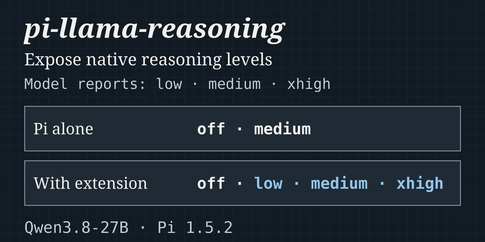

# pi-llama-reasoning

<p>
  <a href="https://www.npmjs.com/package/pi-llama-reasoning"></a>
  <a href="https://www.npmjs.com/package/pi-llama-reasoning"></a>
  <a href="LICENSE"></a>
  <a href="https://pi.dev/packages/pi-llama-reasoning"></a>
</p>

Choose your llama.cpp model’s reasoning levels directly in [Pi](https://pi.dev)—not just thinking on/off.

- Choose supported levels such as `low`, `medium`, and `xhigh` with Pi’s thinking token budgets.
- Keep Pi’s usual login, model picker, and `/llama` commands.
- Keep sessions on separate server slots when available to reduce repeated processing when agents share one model.



## Install

Requires Pi **1.5.2** and Node.js **22.19.0+**.

```bash
pi install npm:pi-llama-reasoning
```

Restart Pi after installing.

## Use

1. Connect to your llama.cpp router with `/login llama.cpp` if you haven’t already.
2. Load a model through `/llama`, then select it through `/model`.
3. Run `/thinking` and choose a reasoning level.

Each level uses Pi’s thinking token budget. Your custom reasoning, budget, and sampling settings are kept. Thinking tokens still count toward the model’s output and context limits.

## Sharing a model between agents

A server slot lets a session reuse its cached conversation between turns. The extension assigns separate slots automatically when available; no extra Pi setup is needed.

Run `/llama-slots` to see which slots are busy and which sessions are assigned to them. The footer shows your session’s slot or why it has no assignment.

Other extensions can turn automatic slot management off or back on while Pi is idle. This lets another extension manage slots without disabling reasoning support or manual inspection. See the [integration contract](vision.md#slot-management-control) for the event and example.

The server needs slot inspection enabled and enough slots for your sessions. For example, our tested three-slot setup uses:

```text
--slots --parallel 3 --kv-unified --no-cache-idle-slots
```

These are **llama.cpp server options**, not Pi options. They allow three requests to share one context pool and avoid clearing idle sessions’ caches on every new request. The extension does not change your server settings. See [vision.md](https://github.com/Ryu-CZ/pi-llama-reasoning/blob/main/vision.md#live-multi-slot-setup-and-verification) for the tested build and setup details.

- Only sessions on the same machine sharing a local cache, server, and model can coordinate slot assignments.
- If no slot is available or inspection fails, requests continue without an assignment and Pi shows a warning.
- Other clients, memory pressure, or model reloads can force the server to process your conversation again. Your explicit slot and cache settings are kept.

## Limits

- Reasoning levels appear only for loaded models that Pi recognizes as reasoning-capable and whose server reports supported level names.
- If discovery fails or the reported levels are unsupported, Pi keeps its usual behavior.
- **Restart Pi** after changing a model’s available reasoning levels; `/reload` won’t refresh them.

See [vision.md](https://github.com/Ryu-CZ/pi-llama-reasoning/blob/main/vision.md) for design, implementation, and development notes.
