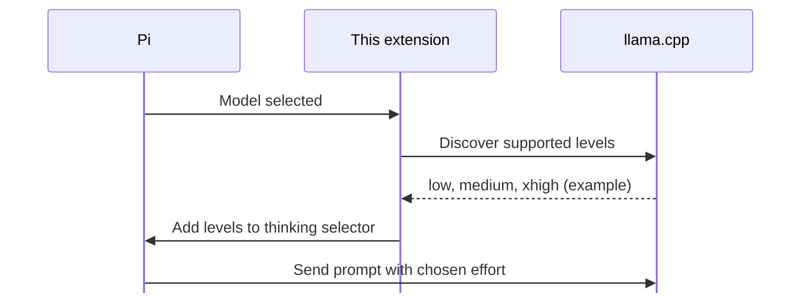

# pi-llama-reasoning

<p>
  <a href="https://www.npmjs.com/package/pi-llama-reasoning"></a>
  <a href="https://www.npmjs.com/package/pi-llama-reasoning"></a>
  <a href="LICENSE"></a>
  <a href="https://pi.dev/packages/pi-llama-reasoning"></a>
</p>

A [Pi coding agent](https://pi.dev) extension that discovers your loaded llama.cpp model’s **native reasoning effort levels** and adds them to Pi’s built-in thinking selector—not just thinking on/off.

- Choose the reasoning efforts reported by your llama.cpp router, such as `low`, `medium`, and `xhigh`.
- Keep using Pi’s connection, model picker, and `/llama` commands. No extra configuration or replacement provider.
- Pair each effort with Pi’s thinking token budget while preserving custom budgets, sampling settings, and explicit reasoning configuration.


## Install

Requires Pi **1.5.2** and Node.js **22.19.0+**.

```bash
pi install npm:pi-llama-reasoning
```

Restart Pi after installing.

## Use

1. Connect to your router with `/login llama.cpp` if you haven’t already.
2. Load a model through `/llama`, then select it through `/model`.
3. Choose a reasoning level in Pi’s thinking selector.

## Limits

- Only discovers levels for loaded models that Pi already recognizes as reasoning-capable.
- Keeps custom reasoning settings, budget overrides, and sampling settings unchanged.
- Per-request thinking budgets override the server’s default reasoning budget, not its total output or context limits.
- **Restart Pi** after changing a model’s available reasoning levels; `/reload` won’t refresh them.
- If discovery is unavailable, keeps Pi’s existing behavior.

## How it works

With the extension, `medium` selects the model’s medium effort—not just thinking on—and sends Pi’s corresponding thinking token budget.

Pi 1.5.2 defaults to 2,048 thinking tokens for `low`, 8,192 for `medium`, and 16,384 for `high`, `xhigh`, or `max`, when those efforts are available. Custom `thinkingBudgets` settings are respected; `xhigh` and `max` use the `high` budget. Pi reduces budgets when needed to reserve answer space within the output limit.

Effort and budget remain different controls: the model’s template interprets effort, while llama.cpp limits thinking tokens. Off mode keeps Pi’s existing thinking toggle and sends no budget.



See [vision.md](https://github.com/Ryu-CZ/pi-llama-reasoning/blob/main/vision.md) for the detailed flow, design decisions, and implementation details.
