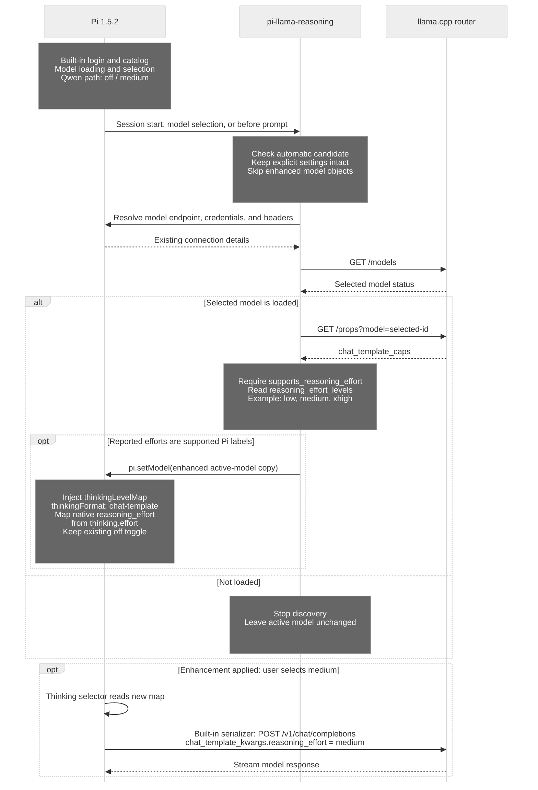

# Vision

## Goal

Seamlessly fix the gaps in Pi’s llama.cpp integration, starting with reasoning controls.

Users connect to a router, load a model, and use Pi’s normal controls. Supported reasoning levels come from the model, not a hardcoded assumption. No parallel provider, model manager, or configuration workflow.

Only add functionality missing from built-in Pi. Other integration gaps need evidence and a defined scope before implementation.

## Current scope

- Discover native reasoning efforts for the selected, loaded router model.
- Expose those efforts through Pi’s existing thinking selector.
- Send the selected effort with Pi’s corresponding thinking token budget, without changing sampling or budget settings.
- Preserve explicit reasoning configuration; fall back when discovery is unavailable.
- Automatically pin sessions to available server slots and expose read-only slot inspection.

No changes to authentication, model loading, downloads, classifiers, or other providers.

## Session slot pinning

### Problem

Two Pi sessions using the same llama.cpp model can displace each other’s cached conversation prefixes. Pi does not currently assign a stable llama.cpp slot to each session; it leaves slot selection to the server. Automatic prefix matching can work, but it does not guarantee separate slots for separate sessions. Repeated prompt evaluation makes alternating agents slow, especially with long contexts.

Multiple slots, parallel requests, continuous batching, and unified KV cache do not establish session-to-slot affinity. Idle-slot caching helps retain prefixes but is a separate mechanism.

### Solution

Enable pinning automatically when the selected loaded model exposes valid slot information. Retain Pi’s built-in provider and generation transport:

- Discover the actual slot count for the selected, loaded model without loading or waking models.
- Assign each participating Pi session a stable slot, coordinated across Pi processes for the same server and model. Hashing session IDs modulo slot count is not sufficient: two sessions can collide.
- Use `before_provider_request` to add `id_slot` and enable `cache_prompt` when not explicitly configured. Preserve explicit request values; account for explicit slot assignments when allocating automatic ones.
- Keep the assignment across turns. Release it when no longer needed and recover abandoned assignments after crashes. Revalidate after server/model changes.
- If discovery fails or no slot is available, keep the request unchanged and warn that pinning is unavailable. Never silently claim isolation or automatically assign a slot already leased to another participating session. Explicit conflicting assignments remain unchanged and produce a warning; they can bypass cooperative ownership.

This coordinates participating extension instances, not arbitrary clients. Other clients can still target the same slots. Pinning also cannot prevent eviction under shared KV memory pressure, model reloads, or cache changes caused by differences in the serialized prompt. It is not a reservation of context capacity or a replacement for server cache configuration.

### Make slot usage inspectable

`/llama-slots` exposes a read-only view of the selected model’s server slots alongside the extension’s session assignments. Show slot ID, busy/idle state, context limit, reported prompt/cache counters, and which slots are leased by participating Pi sessions. Keep server observations separate from local lease ownership: llama.cpp’s slot response does not identify the owning Pi session. Label unavailable or stale observations rather than implying a reservation or reporting zero usage.

Use the model-specific router endpoint `GET /slots?model=…`; `/props?model=…` reports `total_slots` and whether the slots endpoint is enabled. Do not enable endpoints, change server settings, or load models just to inspect them. The footer shows the assigned slot or fallback state. Inspection neither allocates nor releases leases.

### Coordination and lifecycle

Each request discovers the loaded model’s current slot count and state, with a three-second network deadline and Pi’s resolved endpoint, credentials, and headers. Reject malformed or inconsistent reports. Skip newly claimed busy slots; retain an existing assignment even while it is busy. Discovery is independent of reasoning support.

A lazily opened SQLite database at `$XDG_CACHE_HOME/pi-llama-reasoning/slots.sqlite` (default `~/.cache/pi-llama-reasoning/slots.sqlite`) coordinates participating processes using atomic transactions. Node’s built-in SQLite needs no package dependency; Node 22 may emit an experimental warning when first used. Scope keys hash the normalized router URL and model ID; localhost and 127.0.0.1 are normalized together. Other aliases, separate user caches, machines, or PID namespaces are outside this coordination boundary. No prompts or credentials are stored. Existing cache paths are trusted; use a private local user cache, not an untrusted or cross-host shared directory. SQLite write contention has a 200 ms budget rather than blocking Pi for seconds.

Each extension instance has a unique owner token, including separate sessions in one PID. Release its lease on model changes and shutdown, including reload/session replacement. On allocation, reclaim leases only when their PID is definitely dead; permission errors and PID reuse conservatively retain ownership. No timer expires a live owner. A session switch or changed endpoint/model scope releases previous ownership. Server changes are revalidated on the next request, but a restart can still race that observation.

The tested llama.cpp build wraps explicit nonnegative slot IDs modulo its slot count. Normalize only the lease lookup; preserve the original outgoing ID. Preserve explicit `cache_prompt` values, including false; add true only when absent. An explicit automatic-selection value such as `id_slot: -1` bypasses pinning. Later payload-rewriting extensions can still override this extension’s result.

No provider replacement, global settings writes, model loading, or live server changes are needed. Unpinned fallback is deliberate: it preserves Pi availability but can displace a pinned session’s cache. This is not a server-side reservation or strict isolation.

### Verification and remaining evidence

Tests cover concurrent allocation by independent child processes, stable ownership, exhaustion, explicit conflicts, busy slots, crash recovery, rollback, and cleanup. A local HTTP fixture with Pi’s real loader/provider/serializer verifies two independent session runtimes forwarding alternating slot IDs 0/1/0/1, explicit request settings, and a changed server slot count. This is not a live two-slot llama.cpp test.

The user subsequently approved configuring the live model for multiple slots with the full shared context available to one active request. The live multi-slot and near-full-pool checks below passed. Pinning remains best-effort, not a complete cache fix.

### Local inspection and request test

Tested the running router at `http://127.0.0.1:7484` with loaded model `Qwen3.8-27B-Q4_K_M`, backed by `Qwen3.8-27B-UD-Q4_K_M.gguf`, on llama.cpp `b12277-7c2653acc`:

- `/props?model=…` reported `total_slots: 1`, `endpoint_slots: true`, and metrics disabled. The running model uses `--parallel 1`, `--kv-unified`, `--cont-batching`, and `--cache-idle-slots`.
- `/slots?model=…` exposed slot ID, busy state, task ID, context limit, and prompt processing/cache counters without server changes.
- A 64-output-token chat request through the router accepted `id_slot: 0` and `cache_prompt: true`. Inspection observed slot 0 change from idle to busy and back to idle. The response reported 28 prompt tokens and zero cached tokens.
- Idle snapshots reported zero processed/cache counters even though a prompt token count remained. These counters must not be presented as total resident KV usage or total RAM prompt-cache occupancy.

After implementation, a real Pi 1.5.2 session loaded this extension and made two short requests to the same live model. Both outgoing requests carried `id_slot: 0` and `cache_prompt: true`; both returned `OK`. Pi reported 690 uncached input tokens on the first request and 691 cache-read tokens with 19 new input tokens on the follow-up. The `/llama-slots` command reported slot 0 idle, its context/prompt counters, and this session’s lease. The session used a temporary cache directory and released its lease at shutdown.

These initial checks verified live Pi integration, inspectability, and single-session cache reuse only. No presets or server processes were changed during those checks; generation tests did change slot/cache state.

### Live multi-slot setup and verification

With explicit user approval, changed only the upstream Unsloth Q4_K_M preset at `/mnt/m2-games/ai/local_model/configs/models-upstream.ini`: `parallel = 2` and `cache-idle-slots = false`. Retained `ctx-size = 122880`, `kv-unified = true`, `cont-batching = true`, `slots = true`, Q8 K/V, and the existing RAM cache budget. Reloaded the preset catalog and this model only; Kev and embeddings stayed loaded. Other model presets and the Turbo backend were untouched.

The first live two-process test failed its cache-reuse assertion with `cache-idle-slots = true`: both processes had stable distinct IDs and ran concurrently, but one follow-up reprocessed all 948 prompt tokens. In this build, starting a task saves and clears other idle slots under unified KV (`server-context.cpp`, `TAG_IDLE_SLOT_CLEAR`), while selecting an explicit empty slot can bypass the RAM prompt-cache restore path. Stable slot selection alone did not solve that interaction. Keep this failed trial in the evidence; do not recommend enabling eager idle-slot clearing for this tested pinning setup.

Disabling eager clearing resolved the observed failure. Two independent Pi 1.5.2 processes, sharing a temporary lease cache and loading this extension, made simultaneous requests on slots 0 and 1. Inspection observed both slots busy. Alternating follow-ups retained IDs 0/1 and each reported 927 cache-read tokens with 19 fresh input tokens. Both sessions shut down without extension errors.

Both slots reported a 122,880-token context limit. The installed source sets `n_ctx_seq = n_ctx` when unified KV is enabled, rather than dividing by the number of sequences. A native `/completion` request on slot 0 evaluated 122,500 synthetic input tokens plus one output token without truncation, taking about 54.8 seconds. Slot 1 was idle with 947 cached tokens at the start. Logs confirmed it was purged when the shared pool filled, and its prompt counter became zero. This verifies near-full-pool use by one active request and reclamation of idle contents, not 122,880 independent tokens per slot. Two concurrently active contexts must fit in the shared pool together.

The two-process Pi test passed again after the large-context check, with the same 927-token cache reuse for both follow-ups. Runtime evidence is saved locally in `/tmp/pi-live-multislot-evidence.json`, `/tmp/pi-live-multislot-idle-cache-failure.json`, and `/tmp/llama-unified-full-context-evidence.json`. Total GPU usage after the large-context test was about 23,651 MiB with 505 MiB free; this is the observed whole-GPU state, not an isolated KV allocation measurement.

## Information flow

Pi owns the provider, authentication, model management, thinking selector, and request serializer. The extension discovers native efforts and replaces only the active session model with an enhanced copy.



The injected `compat.chatTemplateKwargs` are metadata for Pi’s existing serializer, not a second HTTP client for generation. The extension also retains the Qwen toggle/preservation behavior where applicable. It enables `compat.thinkingTokenBudgetField: "thinking_budget_tokens"` when neither an explicit budget field nor a legacy budget flag is configured. Pi’s serializer then sends the level’s resolved budget alongside its native effort. It does not change budget settings, sampling, the provider catalog, or persistent settings.

Missing or unsupported capabilities and discovery failures leave the model unchanged. The loaded-status guard is best-effort: a shared router can change state between `/models` and `/props`. Generation in the diagram shows the intended request path; live generation remains unverified.

## Design decisions

### Keep the built-in provider

Pi 1.5.2 exposes `pi.setModel()`, which accepts a model copy with an updated thinking map and compatibility settings. The selector and request serializer use that copy.

The extension updates only the active session model. It does not register a provider, mutate the provider catalog, or write settings. This avoids copying Pi’s model-management and authentication code.

### Discover capabilities through llama.cpp

Check `/models` first. Query `/props?model=…` only when the selected model is reported as loaded; querying an unloaded or sleeping model can load or wake it. A shared router can change state between these requests, so the status check is best-effort.

Example `/props` fields:

```json
{
  "chat_template_caps": {
    "supports_reasoning_effort": true,
    "supports_preserve_reasoning": true,
    "reasoning_effort_levels": ["low", "medium", "xhigh"]
  }
}
```

This is a llama.cpp-specific interface, not an OpenAI standard. llama.cpp infers efforts by probing template rendering with `minimal`, `low`, `medium`, `high`, `xhigh`, and `max`. Identical renders may collapse aliases; custom names may be missed.

Only expose recognized, reported efforts. Do not invent aliases such as `high` → `xhigh`. Missing, empty, or unrecognized lists leave Pi’s model unchanged.

### Reuse Pi’s serializer

The enhanced model uses `thinkingFormat: "chat-template"`. Template kwargs resolve through Pi’s existing variables:

- `thinking.enabled`: Pi’s existing thinking toggle, where present.
- `thinking.effort`: selected native effort from the thinking map; omitted when off.
- `preserve_thinking`: retained for Pi’s Qwen toggle path, or enabled when the server reports preservation support.

Selecting `medium` for the Qwen example sends:

```json
{
  "chat_template_kwargs": {
    "enable_thinking": true,
    "preserve_thinking": true,
    "reasoning_effort": "medium"
  },
  "thinking_budget_tokens": 8192
}
```

llama.cpp merges these kwargs over server defaults. Reasoning forwarding needs no separate request-rewriting hook; slot pinning uses the payload hook independently.

### Keep effort, budgets, and off support separate

- Native effort changes the template’s reasoning instructions; it is not a fixed token count.
- Enable Pi’s existing budget serializer rather than defining another effort-to-budget map. Pi 1.5.2 uses 1024 / 2048 / 8192 / 16384 for minimal / low / medium / high; xhigh and max share high’s budget. Custom `thinkingBudgets` are honored. Pi clamps the budget to reserve 1024 answer tokens under the output ceiling; if no positive budget remains, Pi omits the field.
- A per-request `thinking_budget_tokens` value overrides llama.cpp’s `--reasoning-budget` default; it is not bounded by that default. Total output and context limits still apply.
- Explicit budget fields, legacy `supportsThinkingTokenBudget` flags (including false), and per-level sampling overrides remain untouched. Pi merges sampling parameters last, so explicit request-body budget values win.
- An effort list does not establish support for disabling thinking. Preserve Pi’s existing toggle; do not add a new one based on the list alone.

### Preserve explicit configuration

Skip models with `reasoning: false`, custom thinking maps/formats, explicit template kwargs, or an existing native-effort configuration.

This also means the extension cannot distinguish an explicit reasoning disable from a template Pi failed to recognize. For now, Pi must already mark the model as reasoning-capable. Supporting missed templates without overriding user intent needs a clearer configuration/provenance hook.

### Bound discovery and discard stale results

- Discover at session start and model selection.
- Reapply before a prompt when the active model has been replaced with a fresh catalog entry.
- Enhanced models use `chat-template`, so the candidate guard skips them; do not query on every request.
- Use Pi’s resolved endpoint and credentials, including custom headers.
- Bound discovery with a three-second timeout; cancel on model changes or shutdown.
- Discard results if the active model changed while discovery was running.
- Warn once per model on discovery errors; leave its settings unchanged.

### Do not promise rediscovery on reload

Pi 1.5.2 can retain the enhanced active model across `/reload`. The fresh extension instance sees its `chat-template` settings as explicit configuration and skips discovery.

A blind review reproduced this with the actual Pi loader and `session.reload()`: no discovery requests, old efforts retained after the server’s reported capabilities changed. The integration test covers this behavior. Restarting Pi is the current refresh path.

Do not relax override detection just to accept previously enhanced models; that risks overwriting real user configuration.

## Code map

- `extensions/index.ts`: lifecycle hooks, authentication, cancellation, active-model replacement.
- `extensions/lib/discovery.ts`: HTTP discovery, loaded-status guard, slot validation, endpoint paths.
- `extensions/lib/connection.ts`: shared resolution of Pi’s endpoint, credentials, and headers.
- `extensions/lib/slots.ts`: request pinning, lifecycle cleanup, footer state, `/llama-slots` inspection.
- `extensions/lib/slot-leases.ts`: atomic cross-process slot ownership and dead-process reclamation.
- `extensions/lib/reasoning.ts`: pure eligibility checks, capability validation, model transformation.
- `extensions/lib/records.ts`: shared record guard for untrusted JSON; neither domain module depends on the other.
- `tests/lifecycle.test.mjs`: lifecycle, stale results, cancellation, headers, fallback.
- `tests/discovery.test.mjs`: loaded-status guard, URL prefixes, headers, HTTP failures.
- `tests/reasoning.test.mjs`: effort mapping, configuration preservation, capability validation.
- `tests/pi-integration.test.mjs`: actual Pi loader, built-in provider, selector, serializer, reload behavior.
- `tests/slots.test.mjs`: slot payloads, discovery validation, stale results, deadlines, cleanup, inspection.
- `tests/slot-leases.test.mjs`: independent-process allocation, conflicts, crashes, lock contention, rollback.
- `tests/slot-pi-integration.test.mjs`: real Pi session runtimes forwarding slots through the built-in provider.

## Development

```bash
npm ci
npm run check
npm test
npm pack --dry-run
```

Try a checkout without changing Pi settings:

```bash
pi -e ./extensions/index.ts
```

Project setup follows `pi-minimal-footer`: TypeScript under `extensions/`, Node tests, strict type checking, explicit package files, and host-provided Pi packages as peer dependencies.

## Verification

- Pi 1.5.2; Node.js 22.19.0 and 26.10.0.
- Slot implementation: all 54 tests passed on both Node versions; `npm run check`, `npm pack --dry-run`, and `git diff --check` passed. Live single-slot inspection, independent-process multi-slot prefix reuse, and near-full unified-pool use verified as described above. This does not establish strict isolation from other clients or eviction.
- Node tests, including real Pi integration against a local HTTP fixture: default and custom effort budgets, off mode, output-limit clamping, and explicit budget overrides.
- Packed extension loaded through Pi’s loader.
- Read-only discovery against a running llama.cpp router with Qwen3.8-27B reported `low`, `medium`, and `xhigh`.
- Direct live router requests to Qwen3.8-27B with reasoning budgets 0 and 32 verified absent vs bounded reasoning content. Generation through Pi with the new automatic forwarding remains unverified.

## Package discovery experiment

A fresh Pi session in a neutral temporary directory searched public sources with extensions, MCP, skills, context files, and session persistence disabled. Its prompt described the selector-and-budget problem without naming this package or exposing repository metadata. This was one discovery trial, not a ranking benchmark.

Initial queries, recorded before searching:

- `Pi coding agent package llama.cpp reasoning thinking token budget`
- `npm pi llama.cpp native reasoning efforts`
- `github pi extension llama.cpp thinking selector reasoning budget`

After web search hit challenge pages, it searched npm for `pi llama.cpp`, `keywords:pi-package llama`, and `pi reasoning`. It found `pi-llama-cpp` and `pi-reasoning-budget-selector`, but did not find this package or verify a complete native-effort-and-budget solution. Those candidate assessments are the worker’s findings, not an independent audit.

Independent registry checks confirmed that npm still served version 0.1.1 with the old description and only `pi-package`, `pi-extension`, `llama.cpp`, and `reasoning` keywords. This package was absent from the first 250 results for each of the three npm queries; this does not establish absence from all results.

The local description now names both native efforts and token budgets. Keep keywords focused and ordered by relevance: `llama.cpp`, `reasoning-effort`, `thinking-budget`, `reasoning`, `thinking`, `openai-api`, `pi-extension`, then the required gallery marker `pi-package`. The API keyword describes llama.cpp’s OpenAI-compatible endpoint, not a dependency on OpenAI’s hosted service. Avoid standalone budget/effort/token keywords and duplicate spellings. Publish the updated metadata and repeat a fresh blind trial before claiming improved discoverability.

## Code readability

The entry point uses `discovery` and `reasoning` module namespaces to distinguish network I/O from pure transformation. Lifecycle state names identify warned model IDs and pending discovery. Enhanced models already fail the eligibility check because their format is `chat-template`; a separate WeakSet tracked the same exclusion and has been removed. Authentication, cancellation, and active-model replacement stay in the Pi integration layer. Discovery returns raw `/props`, so its name is `fetchLoadedModelProps()`, not an effort parser. `QWEN_THINKING_MAP` names the specific built-in configuration used to detect overrides.

The integration test keeps one real Pi session and local HTTP fixture, with named sequential subtests for discovery, default budgets/off, custom budgets, clamping, catalog replacement, reload, and explicit overrides. Temporary budget/model/server mutations are reset by subtest cleanup. Discovery tests live beside the module they exercise rather than mixing HTTP behavior into the pure transformation tests.

The dead-code/test audit found no unused source exports or obsolete tests. Retained unit and integration overlap covers different boundaries: isolated decisions versus the actual Pi loader/provider/serializer. Strict TypeScript unused checks pass. Node coverage executes every source line (80.12% branch coverage); that supports reachability, not exhaustive branch coverage. All 28 reported tests pass; the increase from 22 comes from naming existing integration scenarios, not new feature coverage. These internal changes do not need a user-facing changelog entry.

## README review corrections

- Verified the usage command against pinned Pi 1.5.2: `handleThinkingCommand()` calls `showThinkingSelector()` when `/thinking` has no argument. README names the existing built-in command; no extension command or runtime behavior changed.
- Documented the all-or-nothing label check in `withReasoningEfforts()`: require `supports_reasoning_effort: true` and a nonempty list containing only Pi-supported effort labels. A mixed list such as `["low", "custom"]` rejects the enhancement, not just the custom entry. Existing malformed-report tests cover this fallback.
- Removed the obsolete budget footer from `media/preview.png` with a bottom crop (1600×900 → 1600×800). Visually checked that the model/version caption and selector comparison remain intact. Removed the historical disclaimer from its README alt text; budget behavior is described in the text, not the image.

## Next evidence needed

- Live generation with each supported effort and off mode.
- A safe refresh path that distinguishes extension-owned metadata from user overrides.
- Support for reasoning-capable templates missed by Pi’s current detection, without overriding explicit disables.

## Documentation boundary

- `README.md`: user setup, usage, and practical limitations.
- `CHANGELOG.md`: concise user-visible release changes only.
- `vision.md`: high-level goal, scope, design decisions, technical details, development, and verification.
- Keep developer notes and implementation history out of README and changelog.
